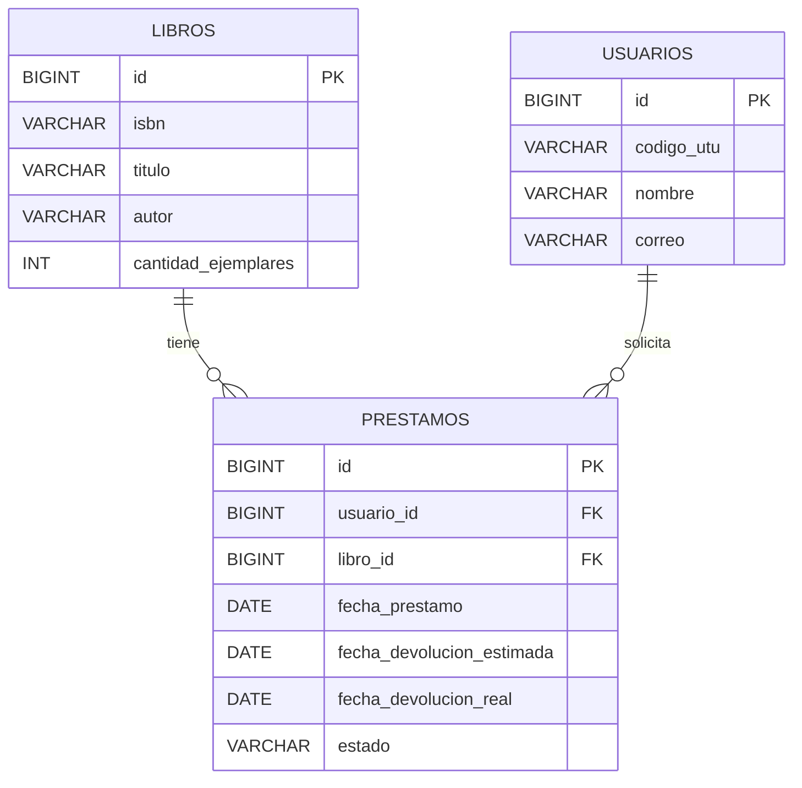

# Biblioteca SENATI

Sistema de Gestión de Biblioteca Universitaria desarrollado como proyecto final del curso
**PDSD-644**. Permite administrar el catálogo de libros, registrar préstamos y devoluciones,
controlar la mora, consultar la disponibilidad mediante una API REST y descargar reportes PDF.
La autenticación de estudiantes se valida contra un directorio **LDAP**.

## Tecnologías

| Capa | Tecnología |
|------|------------|
| Interfaz | Jakarta Faces (JSF) 4.0 · Facelets · XHTML |
| Lógica de negocio | CDI 4.0 (Weld) · beans `@Named` |
| Persistencia | JPA 3.1 · Hibernate 6.4 · JPQL |
| Base de datos | MariaDB / MySQL (`db_biblioteca`) |
| Caché | JCache + Ehcache 3 (segundo nivel de Hibernate) |
| API REST | JAX-RS 3.1 · Jersey 3.1 |
| Reportes | OpenPDF |
| Directorio | JNDI/LDAP · UnboundID (LDAP embebido para demo) |
| Servidor | Apache Tomcat 10.1 |
| Build | Maven · Java 21 |

## Requisitos

- JDK 21
- Maven 3.9+
- MariaDB o MySQL en `localhost:3306` (usuario `root`, sin contraseña por defecto)
- `curl` y `tar` para que el script descargue Tomcat

## Puesta en marcha

### 1. Base de datos

```bash
./scripts/setup-db.sh
```

El script crea `db_biblioteca`, las tablas `libros`, `usuarios` y `prestamos`, y carga
datos de demostración. Si tu base usa otras credenciales:

```bash
DB_USER=root DB_PASS=mi_clave ./scripts/setup-db.sh
```

> También puedes ejecutar manualmente `db/schema.sql` y `db/seed.sql` con tu cliente MySQL.
> La aplicación usa `hibernate.hbm2ddl.auto=update`, por lo que no borra datos existentes.

### 2. Compilar y ejecutar

```bash
./scripts/dev.sh
```

El script compila el WAR, descarga Tomcat 10.1 en `.tools/` (solo la primera vez), despliega
`target/biblioteca.war` y arranca el servidor.

Abre <http://localhost:8080/biblioteca/>.

Para arrancar sin recompilar:

```bash
./scripts/dev.sh --no-build
```

Cambiar el puerto:

```bash
PORT=9090 ./scripts/dev.sh
```

### 3. Accesos de demostración

| Perfil | Usuario | Contraseña |
|--------|---------|------------|
| Bibliotecario | `admin` | `admin123` |
| Estudiante activo | `U2026001` | `123456` |
| Estudiante activo | `U2026002` | `123456` |
| Estudiante inactivo | `U2026003` | `123456` |

Los estudiantes se autentican contra el LDAP embebido. El código `U2026003` existe pero está
inactivo, por lo que el sistema rechaza su ingreso y sus préstamos.

## Funcionalidades

- **Panel**: indicadores de catálogo, usuarios, préstamos activos y mora.
- **Libros**: alta, edición, eliminación y búsqueda por título, autor o ISBN.
- **Usuarios**: padrón de estudiantes sincronizado con LDAP.
- **Préstamos**: registro con validación LDAP, límite de 3 libros activos, control de stock
  con bloqueo pesimista y devolución con reposición del ejemplar.
- **Reportes PDF**: libros más prestados y usuarios con mora, generados con JPQL.
- **Mi cuenta**: el estudiante consulta sus préstamos y cupos disponibles.
- **API REST**: catálogo y disponibilidad de libros, préstamos activos y mora.

## Validadores personalizados

1. `LimitePrestamosValidator`: impide registrar un préstamo cuando el estudiante ya tiene
   3 libros sin devolver.
2. `IsbnValidator`: comprueba el dígito verificador de ISBN-10 e ISBN-13.

## Modelo de datos



- `Libro` **@OneToMany** → `Prestamo`
- `Usuario` **@OneToMany** → `Prestamo`
- `Prestamo` **@ManyToOne** → `Libro` y `Usuario`

## API REST

Base: `/biblioteca/api`

| Método | Ruta | Descripción |
|--------|------|-------------|
| GET | `/libros` | Catálogo completo |
| GET | `/libros/buscar?q=texto` | Búsqueda por título, autor o ISBN |
| GET | `/libros/disponibles` | Libros con stock |
| GET | `/libros/{id}` | Detalle de un libro |
| GET | `/libros/{id}/disponibilidad` | Stock disponible y bandera `disponible` |
| GET | `/prestamos` | Todos los préstamos |
| GET | `/prestamos/activos` | Préstamos sin devolver |
| GET | `/prestamos/mora` | Préstamos vencidos |

Ejemplo:

```bash
curl http://localhost:8080/biblioteca/api/libros/1/disponibilidad
```

## Reportes PDF

- `GET /biblioteca/reportes/libros.pdf` — libros más prestados (últimos 30 días).
- `GET /biblioteca/reportes/mora.pdf` — préstamos vencidos con días de atraso.

Requieren sesión de bibliotecario.

## LDAP

La configuración está en `src/main/resources/ldap.properties`.

- `ldap.mode=embedded`: levanta un directorio UnboundID en memoria en el puerto `10389` con
  los usuarios demo. Es el modo por defecto, no requiere instalar nada.
- `ldap.mode=external`: usa un servidor LDAP real mediante JNDI. Configura
  `ldap.external.url`, `baseDn`, `bindDn`, `bindPassword` y `userFilter`.

La aplicación busca al estudiante por `uid`, lee `cn`, `mail` y `employeeType`, y solo permite
operar a quienes tienen `employeeType=active`. Si el directorio no está disponible se usa un
*fallback* de demostración para los códigos con formato `U` + dígitos.

## Estructura del proyecto

```
biblioteca-senati/
├── db/
│   ├── schema.sql              # creación de tablas
│   └── seed.sql                # datos de demostración
├── scripts/
│   ├── dev.sh                  # compila, descarga Tomcat y ejecuta
│   └── setup-db.sh             # crea la base y carga datos
├── src/main/java/com/senati/biblioteca/
│   ├── bean/                   # beans CDI de JSF
│   ├── converter/              # conversores de JSF
│   ├── dto/                    # objetos de transferencia
│   ├── model/                  # entidades JPA
│   ├── rest/                   # servicios JAX-RS
│   ├── service/                # lógica de negocio y LDAP
│   ├── validator/              # validadores personalizados
│   └── web/                    # filtro de sesión y servlet de PDF
├── src/main/resources/
│   ├── META-INF/persistence.xml
│   ├── ehcache.xml             # caché de segundo nivel
│   └── ldap.properties
├── src/main/webapp/
│   ├── app/                    # vistas internas
│   ├── templates/layout.xhtml
│   ├── resources/css/app.css
│   └── login.xhtml
└── src/test/                   # pruebas JUnit
```

## Pruebas

```bash
mvn test
```

Incluye pruebas del validador de ISBN-10/ISBN-13.

## Autor

Proyecto académico SENATI — PDSD-644.
